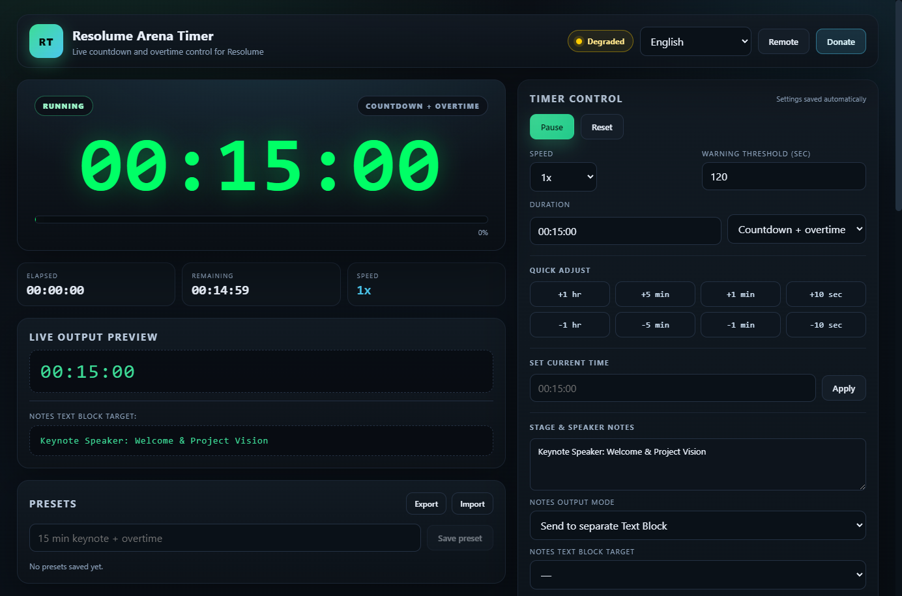

# Resolume Arena Application Timer

<p align="center">
  
</p>

<p align="center">
  
  
  
  
  
</p>

---

## What is Resolume Arena Timer?

**Resolume Arena Application Timer** is an open-source, desktop show timer built specifically for live event visual operators (VJs), stage managers, church media directors, and broadcast technicians.

It manages precision countdowns, count-ups, and overtime tracking, and automatically feeds the formatted time and color status directly into **Resolume Arena** as a **Text Block** (via REST API or OSC).

Beyond Resolume, it features **NDI 6 Video Output** (for OBS Studio, vMix, and video switchers), a full-screen **Web Confidence Monitor** for downstage presenter screens, and an interactive **Smartphone Remote Control** operating over local Wi-Fi.

---

## ⚡ Quick Start in 3 Minutes

1. **Enable Resolume Webserver**:
   - In Resolume Arena, open **Arena** → **Preferences** → **Webserver**.
   - Check **Enabled** (default port `8080`).
2. **Add a Text Block in Resolume**:
   - Under **Sources** → **Generators**, drag **Text Block** into an empty clip slot on any layer.
3. **Connect & Sync**:
   - Open **Resolume Timer**. In the **Resolume Output** panel on the right, click **Scan composition**.
   - Pick your Text Block clip from the dropdown, check **Send timer text to Resolume**, and start your timer!

👉 *For a complete beginner tutorial with screenshots, check the [Step-by-Step Setup Guide](docs/SETUP_GUIDE.md).*

---

## 📚 Complete Documentation

| Guide | Description |
| --- | --- |
| 📖 **[Beginner's Setup Guide](docs/SETUP_GUIDE.md)** | Step-by-step tutorial from downloading to connecting your first Text Block in Resolume. |
| 🖥️ **[Stage Confidence Monitor & NDI Guide](docs/STAGE_NDI_GUIDE.md)** | How to use full-screen web confidence monitors, OBS transparent overlays, and NDI streams. |
| ⚡ **[Resolume Technical & OSC Reference](docs/RESOLUME_GUIDE.md)** | In-depth breakdown of the Resolume REST API (`/api/v1/composition`), parameter IDs, and OSC paths. |
| 🔧 **[Troubleshooting & FAQ](docs/TROUBLESHOOTING.md)** | Solutions for connection issues, firewall setup, scanned targets, and common questions. |

---

## Key Features

### ⏱️ Precision Timer Engine & Modes
- **Countdown Mode ($T_{start} \to 00:00:00$)**: Standard countdown from any custom duration.
- **Count-Up Mode ($00:00:00 \to \infty$)**: Stopwatch and elapsed time tracking.
- **Countdown then Overtime Mode**: Counts down to zero, triggers the **Time Out** state, and seamlessly begins counting upwards (e.g. `+00:02:15`) so you know exactly how much a speaker has run over schedule.
- **On-the-Fly Adjustments**: Quick-add or subtract time (`+1 hr`, `+5 min`, `+1 min`, `+10 sec`, `-10 sec`) live without stopping playback.
- **Speed Remapping**: 0.25x to 2.0x playback speed multiplier for rehearsals or media synchronization.

### 📝 Stage & Speaker Notes (Dual Output Modes)
- **Mode 1 (`\n` on timer)**: Appends stage notes directly underneath the timer on the same Text Block separated by a newline.
- **Mode 2 (Separate Text Block)**: Automatically scans your composition for a secondary Text Block target in Resolume and pushes speaker notes to it independently.

### 📡 NDI 6 Network Video Output
- Broadcasts the live timer, color state, and notes as an uncompressed, low-latency NDI network stream.
- Automatically detected by Resolume Arena, OBS Studio, vMix, and Tricaster without capture cards.
- Configurable stream name, framerate (30 or 60 FPS), and 32-bit BGRA alpha transparency for keying over stage visuals.

### 🖥️ Full-Screen Web Confidence Monitor (`/output`)
<p align="center">
  
</p>

- Clean, high-contrast responsive display served at `http://<lan-ip>:<port>/output` for stage TVs, lectern tablets, and iPads.
- Dynamic color transitions (Green = Running, Amber = Warning threshold, Red = Overtime).
- Transparent video overlay mode: append `?transparent=1` for OBS Studio and vMix Browser Sources.

### 📱 Wireless Smartphone Remote Control (`/`)
<p align="center">
  
</p>

- Click the **Remote** button in the header to view a QR code and instant LAN link.
- Scan with any smartphone or tablet on the same Wi-Fi.
- Wirelessly start, pause, reset, adjust time, toggle playback speed (0.5x–2.0x), and edit stage notes live from backstage or FOH.

### 🛡️ Rock-Solid Background Running
- Never freezes, stops, or desyncs when minimized, unfocused, or running on another virtual desktop.
- Built-in Chromium background timer throttling bypass and OS-level sleep blocker (`powerSaveBlocker`).
- High-precision timestamp delta accumulation ensures millisecond accuracy.

### 🎨 Text Block Color Sync & Time's Up Triggers
<p align="center">
  
</p>

- **Color Sync**: Pushes running, warning, and timeout colors to the Text Block's native `Color` parameter in Resolume Arena as `#rrggbbaa`.
- **Time's Up Actions**: Automatically triggers a clip, column, or group column in Resolume when the timer hits zero.

---

## Resolume Connection Setup

| Setting | Default | Description |
| --- | --- | --- |
| **REST Host** | `127.0.0.1` | Local machine IP (or LAN IP if Resolume is on a separate media server) |
| **REST Port** | `8080` | Resolume Webserver port (Preferences → Webserver) |
| **OSC Host** | `127.0.0.1` | OSC target host |
| **OSC Port** | `7000` | Resolume OSC Input port (Preferences → OSC) |
| **Send Mode** | `Auto` | Prioritizes verified REST API, falls back to OSC |

Text is written to Resolume using `PUT /api/v1/parameter/by-id/{id}`. For multi-machine setups, see the [Resolume Reference Guide](docs/RESOLUME_GUIDE.md).

---

## Requirements

- **Operating System**: Windows 10/11 (64-bit) or macOS (12+).
- **Resolume Arena**: 7.20 through 7.28+ with Webserver enabled.
- **Node.js**: v20+ (for source development and building).

---

## Development & Building

### Run Locally

```powershell
npm install
npm run dev
```

`npm run dev` starts the Vite dev server on port `5173` and launches Electron against it.

### Build Executables

```powershell
npm run build              # Builds React renderer -> dist-renderer/
npm run build:win-portable # Builds standalone Windows portable executable
npm run build:release      # Builds release binaries for current platform
```

Artifacts are saved in `dist/`.

---

## Support This Project (QRIS Donation)

If this software helps your live shows, events, or church services, you can support ongoing development with an Indonesian **QRIS** donation. Any Indonesian mobile banking or e-wallet app (GoPay, OVO, DANA, ShopeePay, LinkAja, BCA, Mandiri, etc.) can scan this code:

<p align="center">
  
</p>

<p align="center"><strong>QRIS only</strong> — thank you for your support!</p>

---

## License

This project is licensed under the [MIT License](LICENSE).
