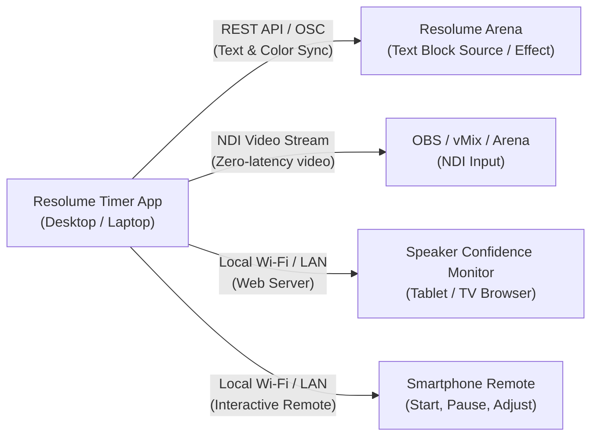

# Beginner's Step-by-Step Setup Guide

Welcome to the **Resolume Arena Application Timer** setup guide! This guide is designed for beginners, live visual operators (VJs), church media volunteers, stage managers, and event technicians who want to set up an automated stage countdown timer that syncs directly into Resolume Arena.

---

## Table of Contents
1. [Overview: How It Works](#overview-how-it-works)
2. [Step 1: Download & Run the Application](#step-1-download--run-the-application)
3. [Step 2: Enable Resolume Arena's Webserver (REST API)](#step-2-enable-resolume-arenas-webserver-rest-api)
4. [Step 3: Create a Text Block in Resolume Arena](#step-3-create-a-text-block-in-resolume-arena)
5. [Step 4: Connect the Timer App to Resolume](#step-4-connect-the-timer-app-to-resolume)
6. [Step 5: Select Your Target & Test Connection](#step-5-select-your-target--test-connection)
7. [Step 6: Choosing Your Timer Operating Mode](#step-6-choosing-your-timer-operating-mode)
8. [Step 7: Adding Stage & Speaker Notes](#step-7-adding-stage--speaker-notes)
9. [Step 8: Setting Up Time's Up Actions](#step-8-setting-up-times-up-actions)
10. [Next Steps](#next-steps)

---

## Overview: How It Works

The app runs on your computer, manages precision countdowns and stage notes, and automatically pushes the formatted time (e.g. `00:14:59`) directly into a **Text Block** in your active Resolume Arena composition.

---

## Step 1: Download & Run the Application

1. Go to the [Releases](https://github.com/rafihadi04/resolume-timer-osc/releases) page on GitHub.
2. Download the latest Windows Portable `.exe` file (e.g., `Resolume-Timer-1.0.0-win.exe`).
3. Double-click the `.exe` to run it. No complex installer or administrative privileges are required.
4. If Windows Defender SmartScreen appears, click **More info** → **Run anyway**.

---

## Step 2: Enable Resolume Arena's Webserver (REST API)

The timer app communicates with Resolume Arena over its high-speed built-in **REST API Webserver**.

1. Open **Resolume Arena** (tested on version 7.20 through 7.28+).
2. Go to the top menu and open **Arena** → **Preferences** (or press `Ctrl + ,` on Windows / `Cmd + ,` on macOS).
3. Select the **Webserver** tab.
4. Ensure the webserver is **Enabled** (checked).
5. Verify the **Port** is set to `8080` (default).

*(Optional for OSC fallback)*:
- If you also want OSC fallback enabled:
  - Go to **Preferences** → **OSC**.
  - Check **OSC Input** and ensure the port is set to `7000`.

> [!TIP]
> Resolume's REST API is the most reliable transport because it confirms message receipt directly with HTTP status codes and parameter IDs.

---

## Step 3: Create a Text Block in Resolume Arena

To show the timer on your stage screens or projectors, Resolume needs a **Text Block** to receive the time text.

You can use either a **Source Clip** or an **Effect**:

### Option A: Text Block as a Source Clip (Recommended)
1. In Resolume, look at the bottom-right panel under **Sources** → **Generators**.
2. Find **Text Block**.
3. Drag and drop **Text Block** into an empty clip slot on any layer (for example, Layer 3, Column 1).
4. Click on the clip to trigger it. You should see default text (e.g., "Resolume") on your output preview.

### Option B: Text Block as a Layer or Clip Effect
1. Under **Effects**, find **Text Block**.
2. Drag and drop it onto an existing clip or onto the layer strip.

---

## Step 4: Connect the Timer App to Resolume

1. Switch to the **Resolume Arena Timer** desktop application.
2. Look at the right-hand panel titled **Resolume Output**.

3. Default connection settings:
   - **REST Host**: `127.0.0.1` (use this if the Timer and Resolume are running on the same PC).
   - **REST Port**: `8080`.
   - **OSC Host**: `127.0.0.1`.
   - **OSC Port**: `7000`.
   - **Send Mode**: `Auto (REST then OSC)`.
4. Ensure the checkbox **Send timer text to Resolume** is checked.
5. If you want the Text Block color in Resolume to automatically change (e.g. Green for running, Yellow for warning, Red for overtime), check **Update Text Block color**.

---

## Step 5: Select Your Target & Test Connection

1. Click the **Scan composition** button in the Resolume Output panel.
2. The app queries Resolume's live composition graph.
3. Once scanned, the **Text Block Target** dropdown will populate with all detected text sources and effects (e.g. `Text Block (Layer 3, Clip 1)`).
4. Select the target you created in Step 3.
5. Click **Send test text**.
6. Switch back to Resolume Arena — you will see the Text Block in Resolume instantly update to test text!

> [!NOTE]
> If the status badge says **🟢 Connected**, Resolume has acknowledged the REST API connection and is actively listening for live timer updates.

### Alternative: Manual OSC Address Routing
If you prefer not to use the REST API, or if your network restricts HTTP:
1. Click the **Manual OSC** button next to *Scan composition*.
2. Enter your target OSC address (e.g. `/composition/layers/1/clips/1/video/source/blocktextgenerator/text`).
3. Click **Apply**. The target will register as `Custom OSC` and all timer text will be broadcast directly via OSC UDP.

---

## Step 6: Choosing Your Timer Operating Mode

The app supports 3 distinct timing modes tailored for live productions:

1. **Countdown Mode ($T_{start} \to 00:00:00$)**:
   - Counts down from your set duration (e.g. `15:00`) to zero, then stops.
2. **Count-Up Mode ($00:00:00 \to \infty$)**:
   - Functions like a precision stopwatch to track elapsed show or set time.
3. **Countdown then Count-Up (Overtime Mode)** *(Recommended for Live Events)*:
   - Counts down to `00:00:00`.
   - When time expires, it enters the **Time Out** state and seamlessly starts counting upwards with a plus sign (e.g. `+00:02:15`).
   - This lets the stage crew, speaker, and VJ know exactly how many minutes the presenter has run over schedule!

> [!TIP]
> **Speed Remapping & Real-Time Time Tracking**: You can accelerate playback (e.g. $2.0x$) during technical rehearsals to test stage cues quickly. The **Elapsed** and **Remaining** statistics on your dashboard and mobile remote accurately track true wall-clock time (`00:02:00` elapsed for 4 minutes of 2x playback, and real remaining time until time's up), keeping your real-world schedule intact while outputs broadcast the active rehearsal countdown.

---

## Step 7: Adding Stage & Speaker Notes

You can send custom notes to the stage (e.g. presenter name, topic, or "2 Minutes Remaining"):

1. Type your text into the **Stage & Speaker Notes** box.
2. Select your **Notes Output Mode**:
   - **Mode 1 (`\n` on timer)**: Appends your notes underneath the timer on the same Text Block separated by a newline.
   - **Mode 2 (Separate Text Block)**: Scans your composition for a secondary Text Block target in Resolume and pushes notes to it independently.

---

## Step 8: Setting Up Time's Up Actions

Want Resolume to automatically trigger a graphic or video clip when the speaker's time runs out?

1. Scroll down to **Time's Up Trigger** in the Resolume Output panel.
2. Check **Enable trigger on zero**.
3. Select the trigger type:
   - **Clip**: Fires a specific clip (e.g. Layer 1, Column 5).
   - **Column**: Triggers an entire column across all layers (e.g. Column 6 - "Wrap Up Graphic").
   - **Group Column**: Triggers a column within a specific layer group.
4. When the countdown hits `00:00:00`, the app automatically fires the trigger in Resolume Arena!

---

## Next Steps

- Want to set up a wireless confidence monitor on an iPad or TV? Read the [Stage & NDI Output Guide](STAGE_NDI_GUIDE.md).
- Having trouble connecting? Check the [Troubleshooting & FAQ](TROUBLESHOOTING.md).
- Interested in advanced OSC paths and REST schema? View the [Resolume Arena Reference Guide](RESOLUME_GUIDE.md).

