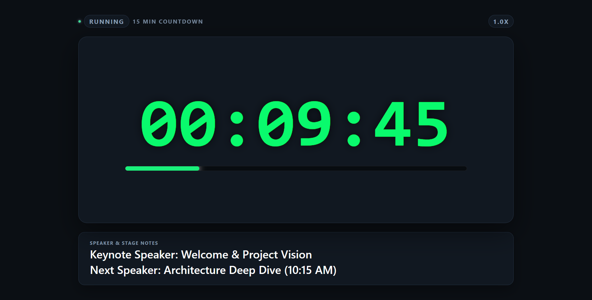
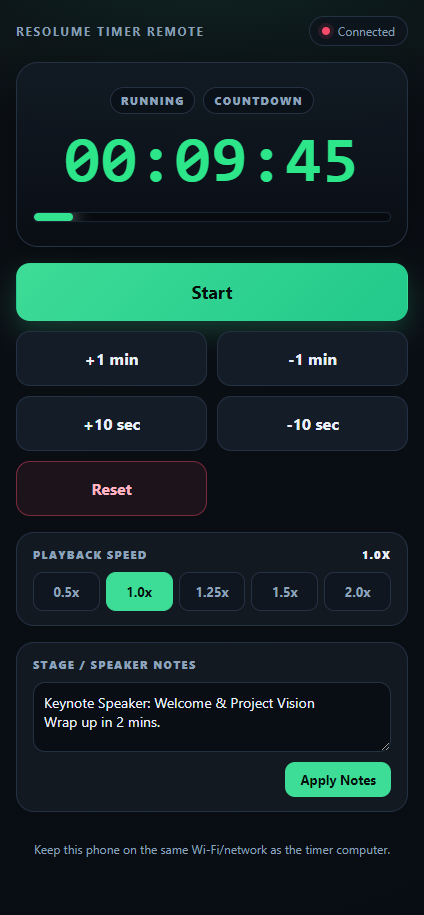
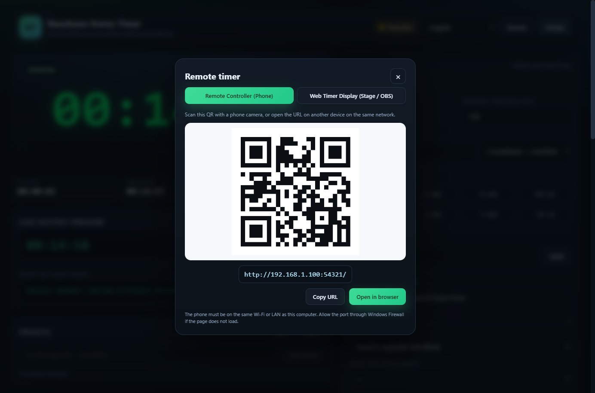
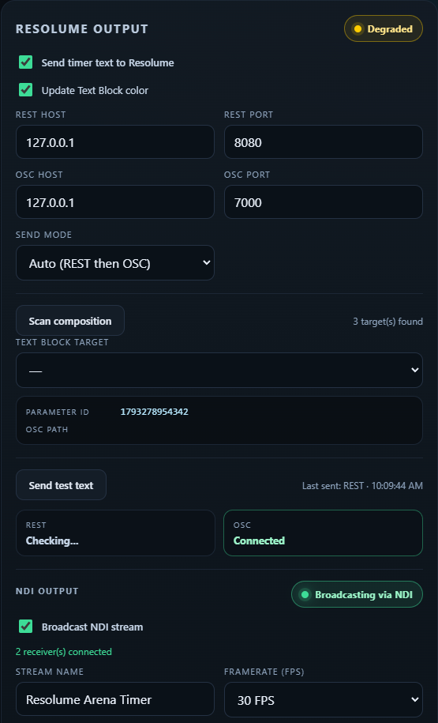

# Stage Confidence Monitor, Web Output & NDI Guide

This guide covers how to use the **Web Confidence Monitor**, **Smartphone Remote Controller**, and **NDI Network Video Output** included in the Resolume Arena Application Timer.

---

## Table of Contents
1. [Web Confidence Monitor (`/output`)](#1-web-confidence-monitor-output)
   - [Display Features](#display-features)
   - [Custom Display URL Parameters](#custom-display-url-parameters)
   - [Setting Up as an OBS Browser Source](#setting-up-as-an-obs-browser-source)
   - [Setting Up in Resolume as a Web Source](#setting-up-in-resolume-as-a-web-source)
2. [Smartphone Remote Controller (`/`)](#2-smartphone-remote-controller-)
   - [How to Connect via Phone](#how-to-connect-via-phone)
   - [Remote Features & Real-Time Sync](#remote-features--real-time-sync)
   - [LAN & Windows Firewall Setup](#lan--windows-firewall-setup)
3. [NDI Network Video Output](#3-ndi-network-video-output)
   - [What is NDI?](#what-is-ndi)
   - [Enabling NDI Output in the App](#enabling-ndi-output-in-the-app)
   - [Receiving the Stream in Resolume Arena](#receiving-the-stream-in-resolume-arena)
   - [Receiving the Stream in OBS Studio & vMix](#receiving-the-stream-in-obs-studio--vmix)

---

## 1. Web Confidence Monitor (`/output`)

The built-in webserver serves a responsive stage display specifically tailored for confidence monitors, downstage TVs, speaker lectern tablets, and video switcher overlays.

### Display Features
- **Ultra High-Contrast Digits**: Large monospace timer designed for readability from 30+ feet away.
- **Dynamic Phase Colors**: Automatically mirrors the active color state (Green = Running, Amber = Warning, Red = Overtime).
- **Speaker & Stage Notes Card**: Prominently shows notes or announcements pushed from FOH or mobile.
- **Notes Color Flashing**: When enabled, the notes card and text pulse vigorously with glowing yellow/red strobe animations to ensure the speaker immediately notices crucial cues.
- **Full-Screen Flash Alert**: When triggered (3s, 5s, 10s), the entire stage screen and NDI output strobe intensely to command the speaker's attention immediately.
- **Live Progress Bar**: Visual percentage completion bar.
- **Auto-Reconnection**: If Wi-Fi drops momentarily, the page automatically reconnects without refreshing.

### Custom Display URL Parameters

You can customize the appearance of the stage display by appending URL parameters to `http://<ip>:<port>/output`:

| URL Parameter | Description | Example |
| --- | --- | --- |
| `?transparent=1` | Removes the dark background for transparent video overlays | `http://192.168.1.100:54321/output?transparent=1` |
| `?notes=hide` | Hides the notes card (timer and progress bar only) | `http://192.168.1.100:54321/output?notes=hide` |
| `?progress=hide` | Hides the bottom progress bar | `http://192.168.1.100:54321/output?progress=hide` |
| `?top=hide` | Hides the top status bar (minimalist layout) | `http://192.168.1.100:54321/output?top=hide` |

> [!TIP]
> Combine parameters using `&`:  
> `http://192.168.1.100:54321/output?transparent=1&notes=hide&top=hide`

---

### Setting Up as an OBS Browser Source

To overlay the live timer directly onto your stream or recording in OBS Studio:

1. In OBS Studio, click **+** under **Sources** and select **Browser**.
2. Name the source (e.g. `Stage Timer Overlay`).
3. Set **URL** to: `http://127.0.0.1:<port>/output?transparent=1`
4. Set **Width** to `1920` and **Height** to `1080`.
5. Check **Shutdown source when not visible** and click **OK**.
6. You now have a transparent, live stage timer overlay with glowing color transitions!

---

### Setting Up in Resolume as a Web Source

If you prefer using Resolume's native web clip renderer:

1. In Resolume Arena, go to **Sources** → **Generators** → **Web**.
2. Drag the **Web** generator into an empty clip slot.
3. In the clip properties panel, paste your output URL: `http://127.0.0.1:<port>/output?transparent=1`
4. Set the resolution to your composition size (e.g. `1920x1080`).

---

## 2. Smartphone Remote Controller (`/`)

The application includes an interactive mobile remote controller that lets stage managers, sound engineers, or emcees control the timer and update notes wirelessly from any phone or tablet on the local network.

### How to Connect via Phone

1. In the main desktop app, click the **Remote** button in the top header.
2. The **Remote Access Modal** will pop up with a QR code and local URL:

3. Point your smartphone's camera at the QR code and tap the link that appears.
4. Your phone's web browser will instantly load the mobile control page!

---

### Remote Features & Real-Time Sync

- **Playback Controls**: Tap **Start**, **Pause**, or **Reset**.
- **On-the-Fly Adjustments**: Quick buttons for `+1 min`, `-1 min`, `+10 sec`, `-10 sec` without stopping the timer.
- **Speed Multiplier**: Adjust playback speed between `0.5x`, `1.0x`, `1.25x`, `1.5x`, and `2.0x` for rehearsals or timing adjustments.
- **Live Notes Editor**: Type speaker notes or stage instructions on your phone and tap **Apply Notes** (or **Clear**) to push notes to stage monitors and NDI feeds without leaking keystrokes.
- **Stage Attention Alerts**: Trigger quick full-screen screen flash alerts (`3s`, `5s`, `10s`) directly from your phone to grab speaker attention, with a one-tap **Stop Screen Flash** button.

---

### LAN & Windows Firewall Setup

If the remote page does not load on your phone:

1. **Verify Same Network**: Ensure your phone and the timer computer are connected to the same Wi-Fi router / subnet.
2. **Windows Defender Firewall**:
   - The first time the app starts, Windows may prompt to allow network access. Ensure **Private networks** is checked.
   - If blocked, open **Windows Defender Firewall** → **Allow an app through firewall** → check **Resolume Timer**.
3. **Router AP Isolation**: Some guest or venue Wi-Fi networks have "Client Isolation" turned on, preventing wireless devices from communicating with each other. Use a dedicated production Wi-Fi router or access point for show reliability.

---

## 3. NDI Network Video Output

The app features native **NDI 6 SDK** broadcast output, streaming the live timer and notes as an uncompressed, low-latency video feed across your local gigabit network.

### What is NDI?
Network Device Interface (NDI) by Vizrt is the industry standard for sending broadcast-quality video over standard Ethernet networks. Any NDI-enabled switcher or media server can discover and receive the stream automatically without video capture cards or HDMI cables.

---

### Enabling NDI Output in the App

1. In the timer app, scroll down to the **NDI Output** section in the **Resolume Output** panel.
2. Check the box **Broadcast NDI stream**.
3. The badge will switch to **🟢 Broadcasting via NDI**.
4. Configure options:
   - **Stream Name**: Default is `Resolume Arena Timer` (visible to all receivers).
   - **Framerate (FPS)**: Choose between `30 FPS` (lightweight, standard) or `60 FPS` (ultra-smooth animations).
   - **Alpha Transparency**: Broadcasts with full 32-bit BGRA alpha channel so backgrounds can be keyed transparently over stage visuals.

---

### Receiving the Stream in Resolume Arena

1. Open **Resolume Arena**.
2. Go to the **Sources** panel on the right side.
3. Scroll down to **NDI Servers**.
4. Expand your computer name: you will see **Resolume Arena Timer**.
5. Drag and drop the NDI source into any clip slot!
6. Trigger the clip — your timer is now a live video feed in your Resolume layers!

---

### Receiving the Stream in OBS Studio & vMix

- **OBS Studio**:
  - Requires the free **OBS-NDI** plugin.
  - In OBS, click **+** → **NDI™ Source** → select `Resolume Arena Timer`.
- **vMix**:
  - Click **Add Input** → **NDI / Desktop Capture**.
  - Select `Resolume Arena Timer` from the local network list.

